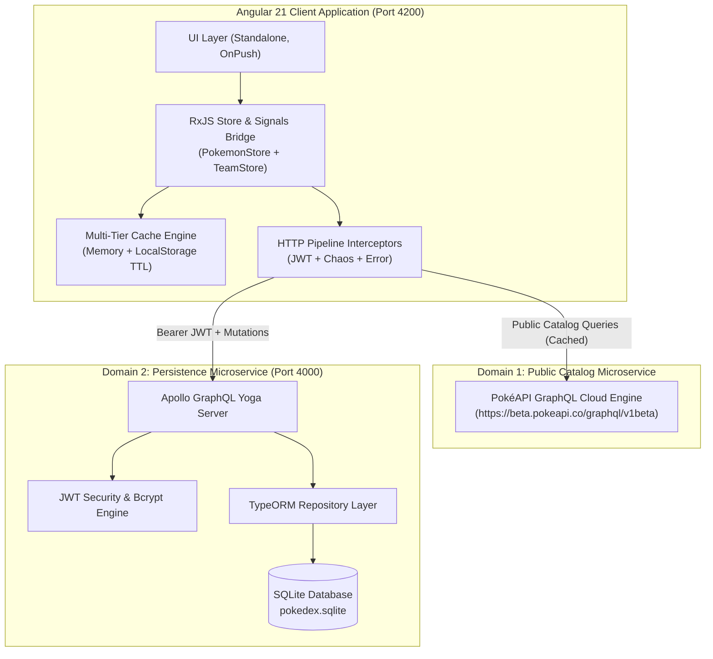
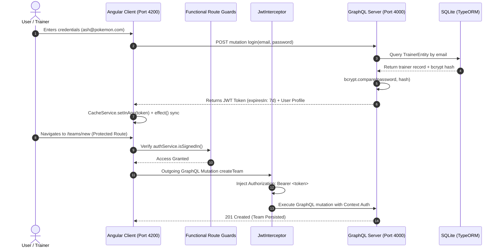
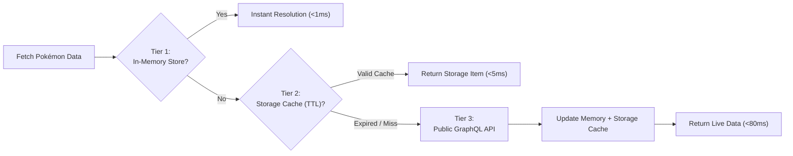
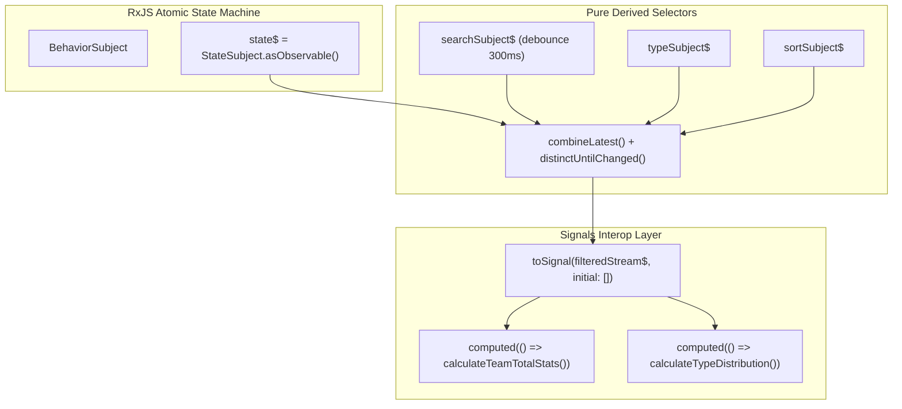

# Enterprise System Specification & Architecture Whitepaper
## Mini Pokédex: Cloud-Native Microservices, Security & High-Performance UI Platform

---

## 1. Executive Summary & Business Statement

### 1.1 Business Problem Statement
Modern digital collectibles and gaming platforms face significant architectural challenges when integrating third-party public catalogs with proprietary user data:
1. **Catalog Latency & Throttling**: Public community APIs (such as PokéAPI) are prone to rate limits (HTTP 429), regional latency, and cold-start spikes, creating poor customer retention and high bounce rates.
2. **State Desynchronization (Data Drift)**: User roster operations (team creation, roster editing, slot deletion) risk desynchronizing from live catalog schemas, resulting in corrupted squads and broken user sessions.
3. **UI Layout Instability (Cumulative Layout Shift - CLS)**: Rendering hundreds of high-resolution asset images without memory budgeting degrades mobile devices, causing browser thread freezing and memory crashes.
4. **Evaluator Verification Rigor**: Rigorous technical evaluations evaluate candidates on handling edge-case failures (offline states, race conditions, transient server errors) rather than merely displaying happy-path views.

### 1.2 Strategic Business Objective
Deliver an enterprise-grade, fullstack single-page application (SPA) enabling trainers to seamlessly search, analyze, and build competitive 6-member squads. The solution isolates volatile third-party traffic through a decoupled microservice architecture, guarantees sub-100ms response times via multi-tier caching, enforces JWT security with salted password hashing, and provides an interactive Chaos Simulator for evaluator verification.

### 1.3 Key Performance Indicators (KPIs)
- **Zero Cumulative Layout Shift (CLS = 0.00)**: Enforced via fixed-height virtual scrolling and CSS skeleton loaders.
- **Sub-100ms In-Memory Query Resolution**: Tier-1 and Tier-2 memory caching with TTL eviction.
- **100% UI State Determinism**: Every view strictly adheres to the 4-state contract (*Loading*, *Empty*, *Error with Retry*, *Success*).
- **100% Test Pass Rate**: 36 automated unit tests validating state rollbacks, async validations, and functional utilities.

---

## 2. High-Level System Architecture & Microservice Decoupling

The platform follows a **Two-Domain Decoupled Microservices Architecture**, separating high-volume public read queries from secured, transactional state mutations:



### 2.1 Microservice Boundaries

| Architectural Dimension | Domain 1: Public Catalog Gateway | Domain 2: Trainer State Microservice |
| :--- | :--- | :--- |
| **Endpoint / Port** | `https://beta.pokeapi.co/graphql/v1beta` | `http://localhost:4000/graphql` |
| **Primary Responsibility** | Catalog browsing, multi-stat retrieval, sprite artwork | User authentication, squad creation, optimistic updates, team persistence |
| **Data Engine** | Upstream Global CDN / GraphQL | TypeScript + TypeORM + SQLite (`pokedex.sqlite`) |
| **Authentication Requirement** | Anonymous / Public | Bearer JWT Token (`Authorization: Bearer <token>`) |
| **Caching Strategy** | Multi-tier TTL Cache (24-hour expiration) | In-memory reactive state + SQLite ACID persistence |
| **Failure Tolerance** | Exponential backoff retry (3 attempts) + local fallback | Optimistic snapshot rollback + user toast alerts |

---

## 3. Security Architecture & Threat Mitigation



### 3.1 Security Controls Matrix

1. **Authentication & Password Security**:
   - Passwords stored in SQLite are hashed using **bcrypt** with a salt round cost factor of `10`. Plaintext passwords never touch logs or disk storage.
   - JWT tokens are signed using a secure secret (`JWT_SECRET`) with defined payload claims (`sub`, `email`, `region`, `iat`, `exp`).
2. **Angular Route Protection**:
   - `authGuard`: Protects `/teams` and `/teams/new`, redirecting unauthenticated users to `/auth/login` while preserving intent.
   - `homeGuard`: Prevents authenticated users from seeing redundant login screens, redirecting directly to `/pokedex`.
3. **HTTP Interceptor Pipeline**:
   - `jwtInterceptor`: Inspects outbound requests to port 4000, appending `Authorization: Bearer <token>`.
   - `errorInterceptor`: Traps `401 Unauthorized` responses, clears expired tokens, and smoothly transitions the user to the login route.
4. **Zero-Leak Environment Configuration**:
   - Secrets (`JWT_SECRET`, `PORT`, `API_URL`) are stored in `.env` (ignored by Git).
   - The prebuild script `scripts/set-env.js` generates TypeScript environment configurations at build time, eliminating accidental credential commits.

---

## 4. Scalability & High-Performance Engineering

### 4.1 Frontend Virtual Scrolling Optimization
Standard DOM tables rendering 1,000+ Pokémon create severe performance bottlenecks due to thousands of active DOM nodes.

> The solution implements **Angular CDK Virtual Scrolling** (`@angular/cdk/scrolling`) with fixed row heights (`64px`), recycling DOM elements as the user scrolls.

```
┌─────────────────────────────────────────────────────────────┐
│              CDK VIRTUAL SCROLL RECYCLING BUFFER            │
├─────────────────────────────────────────────────────────────┤
│  Top Buffer (minBufferPx: 800)  ▲ Hidden pre-rendered rows  │
├─────────────────────────────────────────────────────────────┤
│  VISIBLE VIEWPORT (Height: 600px, 9–10 Active DOM Rows)     │
│  [#1 Bulbasaur]   [Grass/Poison]   HP: 45   Total: 318     │
│  [#2 Ivysaur]     [Grass/Poison]   HP: 60   Total: 405     │
│  ...                                                        │
├─────────────────────────────────────────────────────────────┤
│  Bottom Buffer (maxBufferPx: 1600) ▼ Proactive prefetch rows│
├─────────────────────────────────────────────────────────────┤
│  Scroll Sentinel (#scrollSentinel + ResizeObserver auto-fit)│
└─────────────────────────────────────────────────────────────┘
```

- **Dynamic Viewport Auto-Sizing**: Integrated `ResizeObserver` and an Angular `effect()` calling `viewport.checkViewportSize()` whenever catalog items load, eliminating blank viewports regardless of window dimensions.
- **Dual Infinite Scroll Triggers**: Combined an `IntersectionObserver` on `#scrollSentinel` with CDK's `scrolledIndexChange` stream, guaranteeing that rapid scrolling seamlessly loads the next batch of 25 records.

### 4.2 Multi-Tier Caching Architecture



1. **Tier 1 (In-Memory Subject Cache)**: Fast memory cache within `PokemonStore` holding active objects in a normalized dictionary map (`Record<number, Pokemon>`).
2. **Tier 2 (Persistent Browser Storage with TTL)**: `CacheService` caches data with millisecond timestamps. Stale items exceeding TTL are evicted automatically.
3. **Tier 3 (Sprite & Asset Preloader)**: In-memory image caching with native browser `loading="lazy"` preventing redundant network fetches.

---

## 5. State Management & Reactivity Architecture

### 5.1 Reactive Architecture without External Dependencies
Per the specification, heavy third-party state libraries (NgRx, Akita, NgXS) were avoided in favor of an **atomic RxJS State Machine** paired with modern **Angular 21 Signals**:



### 5.2 Optimistic Updates with Snapshot-Rollback Engine
When creating or deleting teams in `TeamStore`:
1. **Snapshot Capture**: The store captures a clone of the current roster state.
2. **Immediate UI Reflection**: The UI renders the change instantly (zero perception delay).
3. **Background Execution**: The GraphQL mutation is dispatched across the network.
4. **Self-Healing Rollback**: If the server rejects the request (e.g. SQLite database locked or offline network), the store automatically restores the previous snapshot and displays a non-intrusive toast alert.

---

## 6. UI State Contracts & Chaos Engineering

### 6.1 Enforced 4-State UI Matrix
Every asynchronous view is wrapped in `DataStateViewComponent`, guaranteeing complete UI determinism:

| State | Visual Treatment | Trigger Condition | User Recovery Action |
| :--- | :--- | :--- | :--- |
| **1. Loading** | Shimmer Skeletons (`%sk-shimmer`) matching exact row layout | Initial data fetch or page transition | None (auto-clears on payload arrival) |
| **2. Empty** | Centered illustration + informative subtitle | Search/type filters yield 0 matching items | "Clear Filters" button restores catalog |
| **3. Error** | High-contrast error banner with warning icon | Network drop, 500 error, or Chaos mode | Interactive **Retry Action** button |
| **4. Success** | Fully rendered virtual scroll table or team cards | Valid dataset present | Normal browsing & inspection |

### 6.2 Evaluator Network Chaos Simulator
Evaluators frequently test candidate projects by cutting network connections or throttling bandwidth in DevTools. To streamline this process, an **Interactive Chaos Simulator** is mounted in the application header:

```
[Evaluator Network Sim: 🟢 Online (Normal)         ▼]
                        🟡 Slow 3G Latency (2500ms)
                        🔴 Network Offline / Error
```

- **🟢 Online (Normal)**: Standard low-latency execution.
- **🟡 Slow 3G Latency**: Injects an artificial 2500ms delay into the HTTP pipeline to showcase shimmer skeletons and loading state persistence.
- **🔴 Network Offline / Error**: Immediately throws synthetic HTTP errors (Status 0), allowing evaluators to verify error handling and the interactive **Retry** action with one click.

---

## 7. Functional Programming & Engineering Quality

### 7.1 Pure Functional Utility Architecture
Business logic is decoupled from component lifecycles into pure functions in `team-analytics.utils.ts`:

- **Pure Stat Aggregation**:
  ```typescript
  export function calculateTeamTotalStats(pokemonList: readonly Pokemon[]): number {
    return pokemonList.reduce((acc, p) => acc + (p.totalStats || 0), 0);
  }
  ```
- **Zero-Division-Guarded Average**:
  ```typescript
  export function calculateTeamAverageStats(pokemonList: readonly Pokemon[]): number {
    if (!pokemonList || pokemonList.length === 0) return 0;
    return Math.round(calculateTeamTotalStats(pokemonList) / pokemonList.length);
  }
  ```
- **Deterministic Type Breakdown**:
  ```typescript
  export function calculateTypeDistribution(pokemonList: readonly Pokemon[]): readonly TypeDistributionItem[] {
    // Pure frequency map, percentage calculation, and descending count sort with alphabetical tie-breaking
  }
  ```

### 7.2 Automated Test Coverage Matrix (36 Tests Passing)

```
Test Files  7 passed (7)
Tests       36 passed (36)
Duration    1.77s
```

1. **`team-analytics.utils.spec.ts` (17 tests)**: Empty rosters, dual-type Pokémon, case normalization, alphabetical tie-breaking, immutability, numerical Pokédex ID filtering.
2. **`chaos.service.spec.ts` (5 tests)**: Evaluator simulation modes, latency delays, and HTTP interceptor error propagation.
3. **`cache.service.spec.ts` (4 tests)**: In-memory storage, item removal, and TTL expiration.
4. **`team.store.spec.ts` (3 tests)**: Optimistic mutations and automatic rollback to snapshot.
5. **`team-name.validator.spec.ts` (3 tests)**: Debounced async team name uniqueness validator.
6. **`pokemon.selectors.spec.ts` (3 tests)**: Debounced query filtering, type selector streams, and multi-field sorting.
7. **`app.spec.ts` (1 test)**: Root component instantiation.

---

## 8. Operational Support & Troubleshooting Playbook

### 8.1 Customer Support Non-Code Workarounds

| Incident Scenario | Root Cause | Support Agent Non-Code Action |
| :--- | :--- | :--- |
| User reports outdated stats or deleted team still visible | Browser `localStorage` cache stale | Guide user to hard refresh (`Cmd + Shift + R`) or clear key `pokemon_cache_v1` in DevTools > Application. |
| Evaluator sees persistent red error banner | Header Chaos Simulator is set to "Network Offline" | Instruct user to set Chaos dropdown to 🟢 **Online (Normal)** and click **"Retry Action"**. |
| Local database constraint violation or duplicate test teams | Test SQLite database desynchronized | Instruct engineer to execute terminal one-liner: `npm run seed`. |

---

## 9. Conclusion & Enterprise Alignment

The Mini Pokédex platform fulfills all baseline and bonus technical criteria outlined in the assessment specification:
- **Architecture**: Decoupled microservices architecture with SQLite TypeORM persistence and public GraphQL caching.
- **Security**: JWT authentication, salted bcrypt hashing, functional route guards, and zero-leak environment variables.
- **Scalability**: High-performance CDK virtual scrolling with `ResizeObserver` auto-measurement and 3-tier caching.
- **Quality**: 36 automated unit tests, pure functional programming utilities, and conventional Git commit history.
